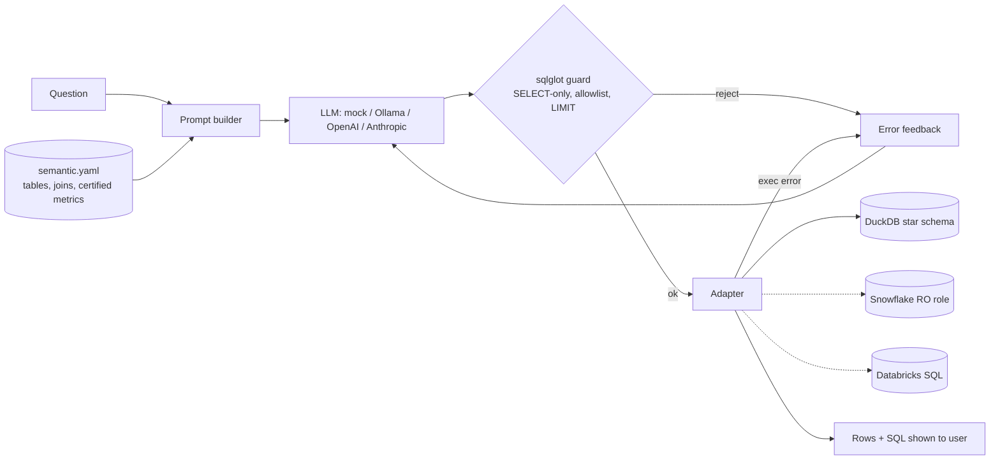

# Lakehouse Text-to-SQL Agent (Governed)

Business users ask questions in plain English, and the agent answers with **safe, certified SQL** against a lakehouse. It runs on DuckDB locally, with Snowflake and Databricks adapters for real warehouses.

## Problem
Letting an LLM write SQL against a warehouse raises three risks: wrong numbers (the wrong metric or join), unsafe statements (DML, exfiltration, runaway scans) and silent failure. This repo addresses each with a semantic layer, AST guardrails and a bounded self-correction loop, then measures accuracy on a benchmark.

## Architecture

The synthetic star schema has `fact_sales` (20k rows) plus `dim_date`, `dim_store`, `dim_product` and `dim_customer`. There's also an `hr_salaries` table that is deliberately left out of the semantic layer, and the guardrails must block it.

## Key design decisions
[ADR 0001](docs/adr/0001-semantic-layer-as-contract.md) semantic layer as contract · [ADR 0002](docs/adr/0002-ast-guardrails.md) AST guardrails · [ADR 0003](docs/adr/0003-self-correction-loop.md) bounded self-correction · [ADR 0004](docs/adr/0004-adapters.md) warehouse adapters

## Benchmark (real run, `t2s bench`, mock LLM = deterministic semantic compiler)
Correctness means the result set matches a hand-written gold query.

| question | correct | attempts |
|---|---|---|
| total revenue | yes | 1 |
| revenue by region | yes | 1 |
| units sold by category | yes | 1 |
| revenue by year | yes | 1 |
| number of orders by loyalty tier | yes | 1 |
| revenue by category in 2025 | yes | 1 |
| top 5 stores by revenue | yes | 1 |
| discount by brand for electronics | yes | 1 |
| average order value by segment | yes | 1 |
| quarterly sales in west | yes | 1 |
| units by city for grocery in 2024 | yes | 1 |
| revenue from gold tier customers by month | no | 1 |
| which region grew revenue the most from 2024 to 2025 | no | 1 |
| share of revenue from electronics | no | 1 |

**Execution accuracy 0.79 (11/14) · guardrail block rate 1.00 (8/8 attacks: DROP, DELETE, UPDATE, INSERT, COPY, stacked statements, a non-allowlisted table, an unknown column) · ~9 ms/question.**

The three misses are intentional: they need period-over-period comparison, ratios, and telling a filter apart from a group-by. They mark where a real LLM (`LLM_PROVIDER=...`) has to take over from the rule-based compiler, and the benchmark makes that gap measurable.

## Quickstart
```bash
python3.11 -m venv .venv && . .venv/bin/activate
make install && make test && make bench
t2s ask "top 5 stores by revenue"
LLM_PROVIDER=ollama LLM_MODEL=qwen2.5-coder:1.5b t2s bench     # compare a real model
pip install -e ".[snowflake]"   # then set SNOWFLAKE_* env vars and use SnowflakeAdapter
```

## Cost note
The default costs **$0**: DuckDB in-process, mock LLM, no network. With a hosted LLM, each question is about 900 prompt tokens (the semantic layer) and 80 output tokens, with up to 3 attempts. On a warehouse, row limits and statement timeouts cap compute. Use an XS warehouse or serverless SQL with auto-suspend.

## Limitations
- The mock "LLM" is a rule-based semantic compiler. It can't do comparisons, ratios or nested logic.
- The Snowflake and Databricks adapters are only tested against mocked connectors, not live accounts.
- There's no row-level security. Use warehouse RLS and masking policies for that.
- The benchmark is small (14 questions).

## License
MIT
